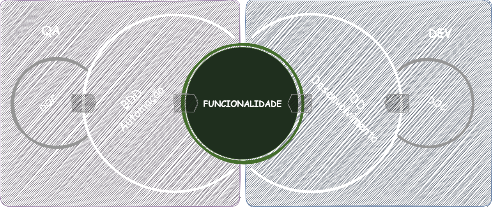
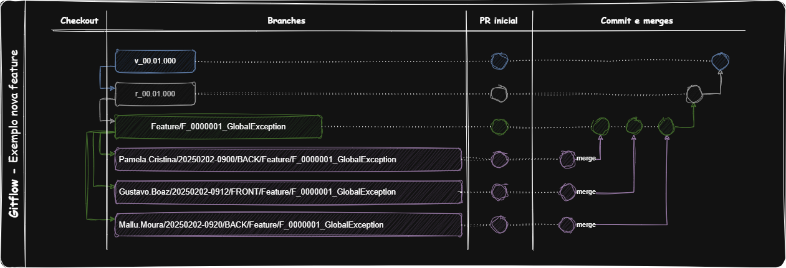
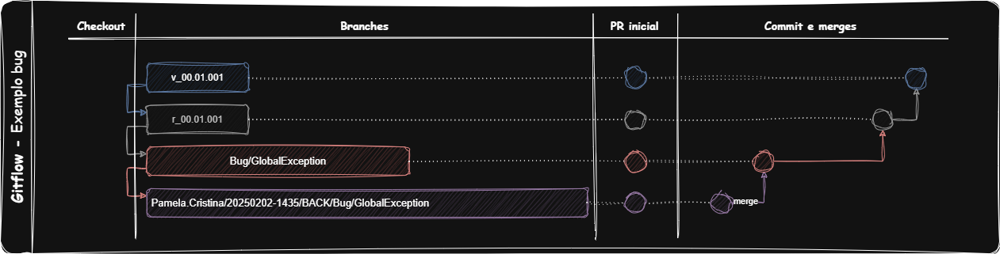

# 🔧 Documentação Backend - Boaz

> 📋 **Índice do Documento**
> - [🔄 Processo de Desenvolvimento](#-processo-de-desenvolvimento)
> - [🧪 Pacote de Qualidade](#-pacote-de-qualidade)  
> - [💻 Pacote de Desenvolvedor](#-pacote-de-desenvolvedor)
> - [📝 Templates e Padrões](#-templates-e-padrões)

<br>

<details>
    <summary>🛠 Visualizar Processo Completo</summary>



<br>

## 🎯 Definição de Ready (DoR)

Antes de iniciar qualquer desenvolvimento, certifique-se que:

- [ ] **Requisitos bem definidos** - História de usuário clara com critérios de aceitação
- [ ] **Análise técnica concluída** - Arquitetura e dependências mapeadas
- [ ] **Estimativa realizada** - Tempo e complexidade avaliados
- [ ] **Ambiente preparado** - Branch, configurações e dependências prontas
- [ ] **Testes planejados** - Cenários de teste documentados

<br>

## 🎯 Definição de Done (DoD)

Uma tarefa só está completa quando:

- [ ] **Código desenvolvido** - Funcionalidade implementada conforme especificação
- [ ] **Testes unitários** - Cobertura mínima de 80%
- [ ] **Testes de integração** - Cenários principais cobertos
- [ ] **Documentação atualizada** - README, diagramas e Gherkin atualizados
- [ ] **Code Review aprovado** - Pelo menos 1 aprovação de dev sênior
- [ ] **Pipeline verde** - Todos os testes automatizados passando
- [ ] **Deploy em homologação** - Funcionalidade testada no ambiente

### <span style="color: green">✨ Novas Funcionalidades</span> - *(quando a solução não existe)*

#### 📋 Etapa 1: Planejamento e Documentação
1. **Product Owner** - Criar user story com critérios de aceitação claros
2. **QA Lead (Pleno/Sênior)** - Revisar requisitos e criar casos de teste iniciais
3. **Tech Lead (Sênior)** - Análise técnica e definição de arquitetura

#### 📝 Etapa 2: Documentação Técnica
4. **QA (Júnior)** - Adicionar seção de ***feature*** no README do módulo
5. **QA Lead (Pleno/Sênior)** - Criar Gherkin detalhado com cenários de teste
6. **DEV (Júnior)** - Criar seção de ***feature*** no README do módulo
7. **DEV (Pleno/Sênior)** - Criar diagramas UML (Classe, Sequência, Componentes)

#### 🧪 Etapa 3: Desenvolvimento de Testes
8. **QA (Júnior/Pleno/Sênior)** - Desenvolver automação de testes (BDD/Cucumber)
9. **DEV (Júnior/Pleno/Sênior)** - Implementar testes unitários e de integração

#### 💻 Etapa 4: Desenvolvimento
10. **DEV (Júnior/Pleno/Sênior)** - Implementar funcionalidade seguindo TDD quando possível
11. **DEV (Pleno/Sênior)** - Code Review obrigatório antes do merge

#### Padrão para Novos Branches (sempre a partir de uma branch de release. Não apagar ao final):
- se nova funcionalidade: feature/[Título-Funcionalidade]
- se novo bug: bug/[Título-Bug]
- se novo spike: spike/[Título-Spike]
#### Padrão de Trabalho nos Branches (sempre a partir de uma branch de feature, 'bug' ou spike. Apagar ao final):
- se funcionalidade: [Responsavel]/[aaaaMMdd-hhMM]/[BACK,FRONT,OTHER]/feature/[Título-Funcionalidade]
- se bug: [Responsavel]/[aaaaMMdd-hhMM]/[BACK,FRONT,OTHER]/bug/[Título-Bug]
- se spike: [Responsavel]/[aaaaMMdd-hhMM]/[BACK,FRONT,OTHER]/spike/[Título-Spike]
#### Padrão de Commit:
- se "funcionalidade": feature/[Descrição commit]
- se "bug": bug/[Descrição commit]
- se "spike": spike/[Descrição commit]

#### Outros Padrões:
- se atualização no projeto: [Responsavel]/[aaaaMMdd-hhMM]/[BACK,FRONT,OTHER]/UPDATE-[Descrição-update]
- se criação no projeto: [Responsavel]/[aaaaMMdd-hhMM]/[BACK,FRONT,OTHER]/CREATE-[Descrição-create]
- se exclusão no projeto: [Responsavel]/[aaaaMMdd-hhMM]/[BACK,FRONT,OTHER]/DELETE-[Descrição-create]

- para pequenas atualizações: [Responsavel]/[BACK,FRONT,OTHER]/UPDATE-[Descrição-update]
- para pequenas criações: [Responsavel]/[BACK,FRONT,OTHER]/CREATE-[Descrição-create]
- para pequenas exclusões: [Responsavel]/[BACK,FRONT,OTHER]/DELETE-[Descrição-create]

<span style="color:orange">**NOTA**</span>
- Desenvolvimento deve ser feito com base na branch home.
- Para desenvolver, crie uma branch de desenvolvimento com base na branch home correspondente a Feature, Bug ou Spike.
- Pull requests devem ser feitos para a branch home. Quando o desenvolvimento estiver concluído, a branch home deve abrir um pull request para a branch de release do projeto.
- Em caso de refatorar durante o projeto, atualize primeiro a documentação Gherkin e os diagramas UML.






### <span style="color: yellow">🔧 Funcionalidades Antigas</span> - *(quando a solução existe, mas precisa de reparos e ajustes)*

#### 📋 Etapa 1: Análise de Impacto
1. **Tech Lead (Sênior)** - Analisar impacto da mudança na arquitetura existente
2. **QA Lead (Pleno/Sênior)** - Analisar impacto nos testes existentes e cenários afetados

#### 📝 Etapa 2: Atualização da Documentação
3. **QA (Pleno/Sênior)** - Atualizar seção de funcionalidade no README do módulo
4. **DEV (Pleno/Sênior)** - Atualizar diagramas UML afetados pela mudança

#### 🧪 Etapa 3: Atualização de Testes
5. **QA (Júnior/Pleno/Sênior)** - Ajustar automação de testes no módulo
6. **DEV (Júnior/Pleno/Sênior)** - Atualizar testes unitários e de integração

#### 💻 Etapa 4: Implementação
7. **DEV (Júnior/Pleno/Sênior)** - Implementar ajustes na funcionalidade
8. **QA (Pleno/Sênior)** - Executar testes de regressão completos


### <span style="color: aqua">🚀 Processo de Release</span> - *(quando a solução está pronta para implantação)*

#### 📋 Etapa 1: Pré-Release
1. **DEV (Pleno/Sênior)** - Garantir que todas as funcionalidades estejam com DoD completo
2. **QA Lead (Sênior)** - Executar suite completa de testes automatizados
3. **Tech Lead (Sênior)** - Revisar arquitetura e performance
4. **DevOps (Pleno/Sênior)** - Preparar ambiente de staging para testes finais

#### 🔄 Etapa 2: Criação do Release
5. **DEV (Pleno/Sênior)** - Realizar merge da branch home via pull request
6. **DEV (Pleno/Sênior)** - Criar **branch de release**: `release/rXX.XX.XXX`
   - `rXX.XX.XXX` representa a versão do release (ex.: `r01.00.000`)
7. **DevOps (Pleno/Sênior)** - Executar pipeline de build e testes automatizados

#### 🧪 Etapa 3: Validação Final
8. **QA (Pleno/Sênior)** - Executar testes de regressão completos no staging
9. **QA (Júnior/Pleno/Sênior)** - Executar testes de aceitação com scenarios reais
10. **Product Owner** - Validar funcionalidades em ambiente de staging

#### 🏷️ Etapa 4: Tagging e Deploy
11. **DEV (Pleno/Sênior)** - Criar tag de versão: `version/vXX.XX.XXX`
12. **DevOps (Sênior)** - Deploy automatizado para produção
13. **Tech Lead (Sênior)** - Verificar health checks pós-deploy

#### 📊 Etapa 5: Monitoramento Pós-Release
14. **DevOps (Pleno/Sênior)** - Monitorar métricas de sistema (CPU, memória, resposta)
15. **QA (Júnior/Pleno/Sênior)** - Executar smoke tests em produção
16. **Product Owner** - Comunicar release para stakeholders
17. **Toda equipe** - Monitoramento ativo por 24h para identificar problemas

#### 🔄 Etapa 6: Rollback (se necessário)
18. **Tech Lead (Sênior)** - Decisão de rollback baseada em métricas e bugs críticos
19. **DevOps (Sênior)** - Executar procedimento de rollback automatizado
20. **QA (Pleno/Sênior)** - Validar sistema após rollback

#### Diretrizes de Versão:
- **Versão 'Major' (XX.00.000):** Mudanças significativas, novas funcionalidades ou alterações que quebram compatibilidade.
- **Versão 'Minor' (00.XX.000):** Novas funcionalidades ou melhorias sem quebrar compatibilidade.
- **Versão 'Patch' (00.00.XXX):** Correções de 'bugs' ou ajustes menores.

#### Exemplo:
- Branch de Release: `r01.02.003`
- Tag de Versão: `v01.02.003`

<span style="color:orange">**NOTA**</span>
- Certifique-se de que toda a documentação (README, Gherkin, diagramas UML) esteja atualizada antes de criar a branch de release.
- Comunique o release a todas as partes interessadas após a implantação.


</details>

<br>
<br>

# 📝 Templates e Padrões

> 📋 **Objetivo:** Padronizar documentação, processos e checklists para garantir qualidade e consistência no desenvolvimento backend.

<details>
  <summary>🛠 Visualizar Templates Completos</summary>

## 🔧 Ferramentas e Stack Backend

### 🔨 Stack de Desenvolvimento
- **Linguagem:** Java 21
- **Framework:** Spring Boot
- **Build:** Maven 3.9.6
- **Containers:** Docker & Docker Compose
- **CI/CD:** GitHub Actions
- **Qualidade:** SonarQube, Jacoco (cobertura de testes)

<br>

### 🤖 Automação de Pipelines
- **Build automatizado** no push/PR para branches principais
- **Testes automatizados** (unitários, integração, aceitação)
- **Análise de qualidade** com métricas automáticas
- **Deploy automatizado** para staging e produção
- **Notificações** em Slack/Teams para builds falhos

<br>

### 📋 Ferramentas de Qualidade
- **Testes unitários:** JUnit 5, Mockito
- **Testes de integração:** TestContainers
- **Testes BDD:** Cucumber
- **Cobertura mínima:** 80% para novos códigos
- **Análise estática:** SpotBugs, PMD, Checkstyle

<br>

## 📊 Processo de QA Backend

### 🎯 Estratégia de Testes
1. **Pirâmide de Testes:**
   - 70% Testes Unitários
   - 20% Testes de Integração  
   - 10% Testes E2E/UI

2. **Tipos de Teste por Funcionalidade:**
   - **Testes de Fumaça** - Cenários críticos principais
   - **Testes de Regressão** - Suite completa automatizada
   - **Testes de Performance** - Carga, stress e volume
   - **Testes de Segurança** - Vulnerabilidades e penetração

<br>

### 🔍 Processo de Revisão de Código
1. **Checklist obrigatório:**
   - [ ] Código segue padrões de estilo definidos
   - [ ] Testes cobrem cenários principais e edge cases
   - [ ] Documentação atualizada (JavaDoc, README)
   - [ ] Não há código duplicado ou dívida técnica
   - [ ] Performance e segurança consideradas
   - [ ] Logs adequados para debug e monitoramento

2. **Aprovação:**
   - **Mínimo:** 1 aprovação de dev Pleno/Sênior
   - **Ideal:** 2 aprovações para mudanças críticas
   - **Obrigatório:** Aprovação de Tech Lead para mudanças arquiteturais

<br>

### 🐛 Processo de Bug Fixing
1. **Priorização:**
   - **P0 (Crítico):** Sistema fora do ar - Fix imediato
   - **P1 (Alto):** Funcionalidade principal quebrada - Fix em 24h
   - **P2 (Médio):** Funcionalidade secundária afetada - Fix em sprint
   - **P3 (Baixo):** Melhorias e ajustes menores - Backlog

2. **Workflow:**
   - Reprodução do bug em ambiente local
   - Criação de teste que falha (reproduz o bug)
   - Implementação do fix
   - Validação que o teste agora passa
   - Testes de regressão para garantir que nada quebrou

<br>

## 📄 Templates de Documentação

### 📋 Template de User Story
```markdown
## 📋 [ID] - Título da User Story

### 👤 Como
[Tipo de usuário]

### 🎯 Eu quero
[Funcionalidade desejada]

### 💡 Para que
[Valor/benefício esperado]

### ✅ Critérios de Aceitação
- [ ] Critério 1
- [ ] Critério 2
- [ ] Critério 3

### 🧪 Cenários de Teste
**Cenário 1:** Caminho feliz
- Dado que...
- Quando...
- Então...

**Cenário 2:** Validação de erro
- Dado que...
- Quando...
- Então...

### 📐 Critérios Técnicos
- [ ] Performance: Tempo de resposta < 200ms
- [ ] Segurança: Validação de entrada
- [ ] Acessibilidade: WCAG 2.1 AA
- [ ] Compatibilidade: Chrome, Firefox, Safari
```

<br>

### 🔄 Template de Pull Request
```markdown
## 📋 Descrição
[Descrição clara do que foi implementado]

## 🔗 Issue/User Story
Closes #[número da issue]

## 🧪 Tipo de Mudança
- [ ] Bug fix (mudança que corrige um problema)
- [ ] Nova funcionalidade (mudança que adiciona funcionalidade)
- [ ] Breaking change (mudança que quebra compatibilidade)
- [ ] Refatoração (mudança que não afeta comportamento)
- [ ] Documentação (apenas mudanças na documentação)

## ✅ Checklist
- [ ] Testes unitários passando
- [ ] Testes de integração passando
- [ ] Documentação atualizada
- [ ] Code review realizado
- [ ] Pipeline verde
- [ ] Testado em ambiente local

## 🧪 Como Testar
1. [Passo 1]
2. [Passo 2]
3. [Resultado esperado]

## 📸 Screenshots (se aplicável)
[Adicionar screenshots da funcionalidade]
```

<br>

### ✅ Checklist de Release
```markdown
## 🚀 Checklist de Release v[X.Y.Z]

### 📋 Pré-Release
- [ ] Todas as user stories da sprint foram concluídas
- [ ] Todos os bugs críticos foram corrigidos
- [ ] Testes automatizados passando (95%+ success rate)
- [ ] Code coverage > 80%
- [ ] Análise de segurança realizada
- [ ] Performance testada e aprovada
- [ ] Documentação atualizada

### 🔄 Durante Release
- [ ] Branch de release criada
- [ ] Tag de versão aplicada
- [ ] Deploy em staging realizado
- [ ] Testes de fumaça em staging passando
- [ ] Deploy em produção realizado
- [ ] Health checks validados
- [ ] Smoke tests em produção passando

### 📊 Pós-Release
- [ ] Métricas de monitoramento normais
- [ ] Logs sem erros críticos
- [ ] Feedback de usuários coletado
- [ ] Comunicação para stakeholders enviada
- [ ] Retrospectiva de release agendada
```

<br>

### 🏗️ Template para Documentação de Módulo
```markdown
## 🔧 [nome_modulo]/ - *[Propósito do Módulo]*

👨‍💻 **Responsabilidade:** [Descrição da responsabilidade do módulo]

<details>
    <summary>🛠 Detalhes do Módulo [Nome]</summary>

### 📊 Status Geral do Módulo
- **Features Totais:** [numero]
- **Features Concluídas:** [numero]  
- **Features em Desenvolvimento:** [numero]
- **Cobertura de Documentação:** [%]
- **Complexidade Ciclomática:** [Baixa/Média/Alta]

### 🎯 Features Implementadas
[Lista de features usando de Novas Features]

### 📊 Métricas do Módulo

| Métrica | Valor Atual | Meta | Status |
|---------|-------------|------|--------|
| **Métrica 1** | [valor] | [meta] | [status] |
| **Métrica 2** | [valor] | [meta] | [status] |

### 🏗️ Arquitetura do Módulo

**🎯 Padrões Utilizados:**
- [Lista de padrões de design]

**📐 Princípios SOLID:**
- [Check de cada princípio]

### 📈 Versioning

| Versão | Data | Descrição | Features | Arquiteto |
|:-------|:-----|:----------|:---------|:----------|
| [ver] | [data] | [desc] | [features] | [nome] |

</details><br>
```

<br>


## 📝 Template para Novas Features de Desenvolvimento
```markdown
<details>
 <summary>🛠 F[NUMERO]/[Nome_da_Feature] - [Status]</summary>

#### 📊 Status da Feature
- 🔵 **Status:** [Em Desenvolvimento/Parado/Concluído]
- 👤 **Responsável DEV:** [Nome do Desenvolvedor]
- 🏗️ **Arquiteto:** [Nome do Arquiteto]
- 📅 **Data Início:** [Data]
- 🎯 **Sprint:** [Sprint Atual]
- ⏱️ **Estimativa:** [X] horas

#### 📋 Informações da Feature

**📝 Descrição Técnica:**
[Descrição detalhada da implementação técnica]

**🎯 Objetivo Arquitetural:**
[Por que esta solução foi escolhida arquiteturalmente]

**🏗️ Decisões de Design:**
- **Padrão 1:** [Justificativa]
- **Padrão 2:** [Justificativa]
- **Tecnologia X:** [Por que foi escolhida]


#### 📐 Especificações Técnicas

**🔧 Componentes Implementados:**
- [Lista de classes e interfaces]

**📦 Estrutura de Pacotes:**
- [estrutura de diretórios e arquivos]

**🔗 Dependências:**
- [Lista de dependências externas]

**⚙️ Configurações:**
- [Configurações necessárias]


#### 🎨 Diagramas Arquiteturais

**📊 Diagrama de Classes:**
[]

**🔄 Diagrama de Sequência:**
[]

**🏗️ Diagrama de Componentes:**
[]


#### 💾 Especificação de Classes

**🔧 [NomeClasse].java**
[Exemplo de código]

**📋 Atributos:**
- [Lista de atributos com descrição]

**🔧 Métodos Principais:**
- [Lista de métodos com descrição]


#### 🧪 Casos de Uso

**1. [Cenário 1]:**
[Exemplo de código]

**2. [Cenário 2]:**
[Exemplo de código]

</details>

#### 📊 Métricas de Qualidade

**🔍 Análise Estática:**
- **Complexidade Ciclomática:** [valor]
- **Linhas de Código:** [valor]
- **Acoplamento:** [Alto/Médio/Baixo]
- **Coesão:** [Alta/Média/Baixa]

**🧪 Cobertura de Testes:**
- **Testes Unitários:** [%]
- **Testes de Integração:** [%]

**⚡ Performance:**
- **[Métrica 1]:** [valor]
- **[Métrica 2]:** [valor]

#### 🔄 Histórico de Alterações

| Data | Versão | Alteração | Arquiteto/Dev |
|------|--------|-----------|---------------|
| [Data] | [Ver] | [Descrição] | [Nome] |

#### 🔮 Próximos Passos
- [ ] [Próximo passo 1]
- [ ] [Próximo passo 2]

```

<br>

## 📝 Template para Novas Features de QA
```markdown
<details>
  <summary>🛠 F[NUMERO]/[Nome_da_Feature] - [Status]</summary>

#### 📊 Status da Feature
- 🔵 **Status:** [Em Desenvolvimento/Parado/Concluído]
- 👤 **Responsável QA:** [Nome do QA]
- 📅 **Data Início:** [Data]
- 🎯 **Sprint:** [Sprint Atual]
- ⏱️ **Estimativa:** [X] horas

#### 📋 Informações da Feature

**📝 Descrição Resumida:**
[Breve descrição da funcionalidade]

**🎯 Objetivo de Negócio:**
[Por que esta feature é importante]

**👥 Stakeholders:**
- [Lista de stakeholders e como são impactados]

#### 📋 Especificação Técnica

**🔧 Componentes a Serem Testados:**
- [Lista de classes, métodos, endpoints a testar]

**📐 Critérios de Aceitação:**
- [ ] [Critério 1]
- [ ] [Critério 2]
- [ ] [Critério 3]

**🧪 Cenários de Teste Principais:**
1. **[Nome Cenário 1]** - [Descrição]
2. **[Nome Cenário 2]** - [Descrição]

#### 🥒 Especificação Gherkin


Feature: F[NUMERO]/[Nome_da_Feature]
  """
  Como [tipo de usuário]
  Eu quero [funcionalidade]
  Para que [benefício/valor]
  
  Regras de Negócio:
  - [Regra 1]
  - [Regra 2]
  """

  Background:
    Given [pré-condições comuns]

  @smoke @critical
  Scenario: [Nome do cenário principal]
    Given [pré-condição]
    When [ação]
    Then [resultado esperado]
    And [validação adicional]

  @[tag] @[categoria]
  Scenario Outline: [Nome do cenário com exemplos]
    Given [pré-condição com "<parametro>"]
    When [ação com "<parametro>"]
    Then [resultado com "<parametro>"]

    Examples:
      | parametro | valor_esperado |
      | valor1    | resultado1     |
      | valor2    | resultado2     |


#### 🔬 Cenários de Teste Detalhados

**🧪 Testes Unitários Relacionados:**
- [Lista de classes de teste]

**🔗 Testes de Integração:**
- [Lista de testes de integração]


**📊 Métricas de Qualidade:**
- **Cobertura de Código:** [%] (meta: 80%)
- **Cenários BDD:** [numero] implementados
- **Casos de Teste:** [numero] total
- **Tempo de Execução:** [tempo] (meta: < 5s)

#### 🔄 Histórico de Alterações

| Data | Versão | Alteração | Responsável |
|------|--------|-----------|-------------|
| [Data] | [Ver] | [Descrição] | [Nome] |
```

<br>


## 📈 Métricas e Monitoramento

### 📊 KPIs de Desenvolvimento
- **Velocity:** Story points entregues por sprint
- **Lead Time:** Tempo entre início e entrega de uma funcionalidade
- **Cycle Time:** Tempo de desenvolvimento efetivo
- **Code Coverage:** Percentual de código coberto por testes (meta: >80%)
- **Technical Debt:** Tempo estimado para corrigir problemas identificados

<br>

### 🔍 Métricas de Qualidade
- **Bug Rate:** Bugs encontrados por funcionalidade entregue
- **Defect Escape Rate:** Bugs que chegaram à produção
- **Test Automation Rate:** Percentual de testes automatizados
- **Code Review Coverage:** Percentual de código revisado
- **First Time Right:** Percentual de deploys sem rollback

<br>

### 🚀 Métricas de Performance
- **Build Time:** Tempo de execução do pipeline de CI/CD
- **Deployment Frequency:** Frequência de deploys em produção
- **Mean Time to Recovery (MTTR):** Tempo médio para corrigir problemas
- **Change Failure Rate:** Percentual de deploys que causaram problemas

<br>

### 📱 Monitoramento de Sistema
- **Application Performance Monitoring (APM):** New Relic/Datadog
- **Log Management:** ELK Stack (Elasticsearch, Logstash, Kibana)
- **Infrastructure Monitoring:** Prometheus + Grafana
- **Alerting:** PagerDuty/OpsGenie para incidentes críticos

<br>

### 📊 Dashboard de Métricas
- **Business Metrics:** Usuários ativos, conversão, revenue
- **Technical Metrics:** Response time, throughput, error rate
- **Team Metrics:** Velocity, burndown, code quality
- **Operational Metrics:** Uptime, deployment success rate

</details>

<br>
<br>

# 🧪 Pacote de Qualidade

> 📋 **Objetivo:** Documentar e organizar todos os testes automatizados, cenários BDD e validações de qualidade do projeto.

<details>
  <summary>🛠 Visualizar Pacote Completo</summary>

## 📚 Estrutura do Pacote de Qualidade

### 🎯 Propósito
- **Testes de Aceitação:** Automação BDD com Cucumber
- **Validação de Cenários:** Gherkin para cada funcionalidade
- **Rastreabilidade:** Ligação entre requisitos e testes
- **Documentação Viva:** Especificações executáveis

### 🏗️ Organização por Módulos

```
📁 Pacote de Qualidade/
├── 📂 core/                    # Testes do módulo core
├── 📂 ms_user/                 # Testes do microserviço de usuários
├── 📂 ms_quiz/                 # Testes do microserviço de quiz
├── 📂 ms_live/                 # Testes do microserviço de lives
├── 📂 ms_mono/                 # Testes do microserviço monolítico
└── 📂 ms_auth/                 # Testes do microserviço de autenticação
```

<br>

## 🔧 core/ - *Módulo Base*

👨‍💻 **Responsabilidade:** Testes de aceitação para componentes base do sistema. Automação BDD para funcionalidades core.

<details>
    <summary>🛠 Detalhes do Módulo Core</summary>

### 📊 Status Geral do Módulo
- **Features Totais:** 1
- **Features Concluídas:** 0  
- **Features em Desenvolvimento:** 1
- **Cobertura de Testes:** 85%

### 🎯 Features Implementadas


<br>

### 📊 Métricas do Módulo Core

| Métrica | Valor Atual | Meta | Status |
|---------|-------------|------|--------|
| **Cobertura de Testes** | 85% | 0% | ✅ |
| **Scenarios BDD** | 5 | 0 | 🔄 |
| **Tempo Execução** | 1.8s | < 0s | ✅ |
| **Taxa de Sucesso** | 95% | 0% | 🔄 |

### 📈 Versioning

| Versão | Data | Descrição | Features |
|:-------|:-----|:----------|:---------|
| `00.02` | - | Próxima versão | F0000001 |

</details><br>


</details>

<br><br>

</details>

# 💻 Pacote de Desenvolvedor

> 📋 **Objetivo:** Documentar arquitetura, diagramas UML, especificações técnicas e decisões de design para cada módulo do sistema.

<details>
  <summary>🛠 Visualizar Pacote Completo</summary>

## 📚 Estrutura do Pacote de Desenvolvedor

### 🎯 Propósito
- **Documentação Técnica:** Arquitetura e design de cada módulo
- **Diagramas UML:** Visualização de classes, sequências e componentes
- **Especificações:** Detalhes técnicos para implementação
- **Decisões de Design:** Justificativas arquiteturais e padrões

### 🏗️ Organização por Módulos

```
📁 Pacote de Desenvolvedor/
├── 📂 core/                    # Documentação do módulo core
├── 📂 ms_user/                 # Documentação do microserviço de usuários
├── 📂 ms_quiz/                 # Documentação do microserviço de quiz
├── 📂 ms_live/                 # Documentação do microserviço de lives
├── 📂 ms_mono/                 # Documentação do microserviço monolítico
└── 📂 ms_auth/                 # Documentação do microserviço de autenticação
```

---

## 🔧 core/ - *Módulo Base*

👨‍💻 **Responsabilidade:** Base de códigos comuns do sistema. Toda lógica de negócio fundamental e componentes compartilhados são implementados aqui.

<details>
    <summary>🛠 Detalhes do Módulo Core</summary>

### 📊 Status Geral do Módulo
- **Features Totais:** 1
- **Features Concluídas:** 0  
- **Features em Desenvolvimento:** 1
- **Cobertura de Documentação:** 85%
- **Complexidade Ciclomática:** Baixa (< 10)

### 🎯 Features Implementadas


<br>

### 📊 Métricas do Módulo Core

| Métrica | Valor Atual | Meta | Status |
|---------|-------------|------|--------|
| **Cobertura de Documentação** | 85% | 80% | ✅ |
| **Diagramas Atualizados** | 3/4 | 100% | 🔄 |
| **Complexidade Média** | 6 | < 10 | ✅ |
| **Technical Debt** | 2h | < 8h | ✅ |

### 🏗️ Arquitetura do Módulo

**🎯 Padrões Utilizados:**
- **Strategy Pattern** - Para diferentes tipos de erro
- **Factory Pattern** - Para criação de exceções
- **Builder Pattern** - Para contexto adicional
- **Singleton Pattern** - Para catálogo de erros

**📐 Princípios SOLID:**
- ✅ **SRP** - Cada classe tem responsabilidade única
- ✅ **OCP** - Extensível para novos tipos de erro
- ✅ **LSP** - Substitution principle respeitado
- ✅ **ISP** - Interfaces específicas e coesas
- ✅ **DIP** - Dependências invertidas via interfaces

### 📈 Versioning

| Versão | Data | Descrição | Features | Arquiteto |
|:-------|:-----|:----------|:---------|:----------|
| `00.01` | 2024-01-15 | Versão inicial | F0000001 | [Nome] |
| `00.02` | - | Próxima versão | F0000002, F0000003 | [Nome] |

</details><br>


</details>

<br>
