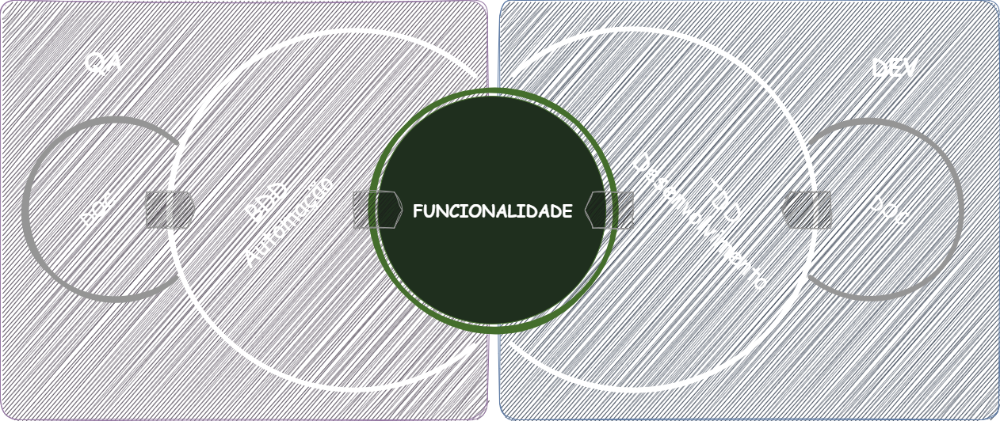
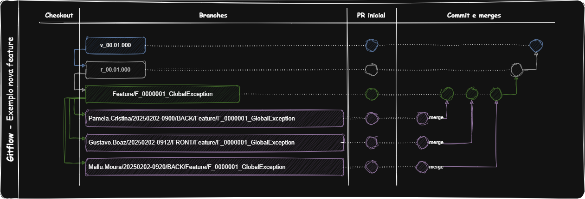
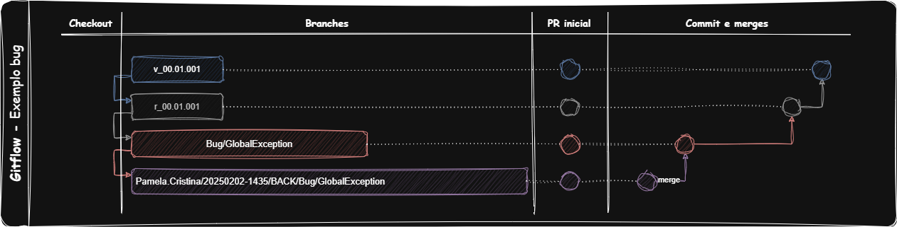

# 🎨 Documentação Frontend - Boaz

> 📋 **Índice do Documento**
> - [🔄 Processo de Desenvolvimento](#-processo-de-desenvolvimento-frontend)
> - [🧪 Pacote de Qualidade Frontend](#-pacote-de-qualidade-frontend)  
> - [💻 Pacote de Desenvolvedor Frontend](#-pacote-de-desenvolvedor-frontend)
> - [📝 Templates e Padrões](#-templates-e-padrões-frontend)

<br>

<details>
    <summary>🛠 Visualizar Processo Completo</summary>



<br>

## 🎯 Definição de Ready (DoR) - Frontend

Antes de iniciar qualquer desenvolvimento frontend, certifique-se que:

- [ ] **UI/UX Designs aprovados** - Mockups, wireframes e protótipos validados
- [ ] **Componentes mapeados** - Identificação de componentes reutilizáveis
- [ ] **Responsividade definida** - Breakpoints e comportamento mobile-first
- [ ] **Acessibilidade planejada** - Critérios WCAG 2.1 AA definidos
- [ ] **Performance budget** - Limites de bundle size e Core Web Vitals
- [ ] **Testes de usabilidade** - Cenários e personas definidos

<br>

## 🎯 Definição de Done (DoD) - Frontend

Uma tarefa frontend só está completa quando:

- [ ] **Componente desenvolvido** - Funcionalidade implementada conforme design
- [ ] **Testes unitários** - Cobertura mínima de 80% para componentes
- [ ] **Testes E2E** - Cenários principais automatizados com Cypress/Playwright
- [ ] **Responsividade testada** - Desktop, tablet e mobile validados
- [ ] **Acessibilidade validada** - WCAG 2.1 AA compliance verificado
- [ ] **Performance aprovada** - Core Web Vitals dentro do budget
- [ ] **Cross-browser testado** - Chrome, Firefox, Safari e Edge
- [ ] **Storybook atualizado** - Documentação de componentes
- [ ] **Code Review aprovado** - Pelo menos 1 aprovação de dev frontend sênior

### <span style="color: green">✨ Novas Funcionalidades Frontend</span> - *(quando a solução não existe)*

#### 📋 Etapa 1: Design e Planejamento
1. **UX/UI Designer** - Criar wireframes e protótipos interativos
2. **Frontend Lead (Sênior)** - Análise técnica e definição de arquitetura de componentes
3. **QA Lead (Pleno/Sênior)** - Revisar requisitos de acessibilidade e usabilidade

#### 📝 Etapa 2: Documentação Técnica
4. **QA (Júnior)** - Adicionar seção de ***feature*** no README do módulo
5. **QA Lead (Pleno/Sênior)** - Criar Gherkin com cenários de UI/UX
6. **DEV Frontend (Júnior)** - Criar seção de ***feature*** no README do módulo
7. **DEV Frontend (Pleno/Sênior)** - Criar diagramas de componentes e fluxo de dados

#### 🧪 Etapa 3: Desenvolvimento de Testes
8. **QA (Júnior/Pleno/Sênior)** - Desenvolver automação E2E (Cypress/Playwright)
9. **DEV Frontend (Júnior/Pleno/Sênior)** - Implementar testes unitários (Jest/Vitest)
10. **DEV Frontend (Pleno/Sênior)** - Configurar testes de acessibilidade automatizados

#### 💻 Etapa 4: Desenvolvimento
11. **DEV Frontend (Júnior/Pleno/Sênior)** - Implementar componentes seguindo atomic design
12. **DEV Frontend (Pleno/Sênior)** - Code Review obrigatório com foco em performance e acessibilidade

#### 🎨 Etapa 5: Validação UI/UX
13. **UX/UI Designer** - Validar implementação contra designs aprovados
14. **QA (Pleno/Sênior)** - Executar testes de usabilidade e acessibilidade

#### Padrão para Novos Branches (sempre a partir de uma branch de release. Não apagar ao final):
- se nova funcionalidade: feature/[Título-Funcionalidade]
- se novo bug: bug/[Título-Bug]
- se novo spike: spike/[Título-Spike]
#### Padrão de Trabalho nos Branches (sempre a partir de uma branch de feature, 'bug' ou spike. Apagar ao final):
- se funcionalidade: [Responsavel]/[aaaaMMdd-hhMM]/[BACK,FRONT,OTHER]/feature/[Título-Funcionalidade]
- se bug: [Responsavel]/[aaaaMMdd-hhMM]/[BACK,FRONT,OTHER]/bug/[Título-Bug]
- se spike: [Responsavel]/[aaaaMMdd-hhMM]/[BACK,FRONT,OTHER]/spike/[Título-Spike]
#### Padrão de Commit:
- se "funcionalidade": feature/[Descrição commit]
- se "bug": bug/[Descrição commit]
- se "spike": spike/[Descrição commit]

#### Outros Padrões:
- se atualização no projeto: [Responsavel]/[aaaaMMdd-hhMM]/[BACK,FRONT,OTHER]/UPDATE-[Descrição-update]
- se criação no projeto: [Responsavel]/[aaaaMMdd-hhMM]/[BACK,FRONT,OTHER]/CREATE-[Descrição-create]
- se exclusão no projeto: [Responsavel]/[aaaaMMdd-hhMM]/[BACK,FRONT,OTHER]/DELETE-[Descrição-create]

- para pequenas atualizações: [Responsavel]/[BACK,FRONT,OTHER]/UPDATE-[Descrição-update]
- para pequenas criações: [Responsavel]/[BACK,FRONT,OTHER]/CREATE-[Descrição-create]
- para pequenas exclusões: [Responsavel]/[BACK,FRONT,OTHER]/DELETE-[Descrição-create]

<span style="color:orange">**NOTA**</span>
- Desenvolvimento deve ser feito com base na branch home.
- Para desenvolver, crie uma branch de desenvolvimento com base na branch home correspondente a Feature, Bug ou Spike.
- Pull requests devem ser feitos para a branch home. Quando o desenvolvimento estiver concluído, a branch home deve abrir um pull request para a branch de release do projeto.
- Em caso de refatorar durante o projeto, atualize primeiro a documentação Gherkin e os diagramas UML.






### <span style="color: yellow">🔧 Funcionalidades Antigas Frontend</span> - *(quando a solução existe, mas precisa de reparos e ajustes)*

#### 📋 Etapa 1: Análise de Impacto UI/UX
1. **UX/UI Designer** - Analisar impacto visual e de usabilidade da mudança
2. **Frontend Lead (Sênior)** - Analisar impacto na arquitetura de componentes existentes
3. **QA Lead (Pleno/Sênior)** - Analisar impacto nos testes E2E e cenários de usabilidade

#### 📝 Etapa 2: Atualização da Documentação
4. **QA (Pleno/Sênior)** - Atualizar seção de funcionalidade no README do módulo
5. **DEV Frontend (Pleno/Sênior)** - Atualizar diagramas de componentes e Storybook

#### 🧪 Etapa 3: Atualização de Testes
6. **QA (Júnior/Pleno/Sênior)** - Ajustar automação E2E e testes de acessibilidade
7. **DEV Frontend (Júnior/Pleno/Sênior)** - Atualizar testes unitários e snapshots

#### 💻 Etapa 4: Implementação
8. **DEV Frontend (Júnior/Pleno/Sênior)** - Implementar ajustes no componente/funcionalidade
9. **UX/UI Designer** - Validar mudanças contra padrões de design system
10. **QA (Pleno/Sênior)** - Executar testes de regressão visual e funcional

### <span style="color: aqua">🚀 Processo de Release Frontend</span> - *(quando a solução está pronta para implantação)*

#### 📋 Etapa 1: Pré-Release
1. **Frontend Lead (Sênior)** - Garantir que todas as funcionalidades estejam com DoD completo
2. **QA Lead (Sênior)** - Executar suite completa de testes E2E e acessibilidade
3. **UX/UI Designer** - Validação final de design system e consistência visual
4. **DevOps (Pleno/Sênior)** - Preparar ambiente de staging para testes finais

#### 🔄 Etapa 2: Build e Otimização
5. **Frontend Lead (Sênior)** - Realizar merge da branch home via pull request
6. **Frontend Lead (Sênior)** - Criar **branch de release**: `release/rXX.XX.XXX`
7. **DevOps (Pleno/Sênior)** - Executar build otimizado e análise de bundle
8. **Frontend Lead (Sênior)** - Validar bundle size e Core Web Vitals

#### 🧪 Etapa 3: Validação Final
9. **QA (Pleno/Sênior)** - Executar testes de regressão completos no staging
10. **QA (Júnior/Pleno/Sênior)** - Executar testes cross-browser e responsividade
11. **UX/UI Designer** - Validar experiência do usuário em staging
12. **Product Owner** - Validar funcionalidades com stakeholders

#### 🏷️ Etapa 4: Deploy e Monitoring
13. **Frontend Lead (Sênior)** - Criar tag de versão: `version/vXX.XX.XXX`
14. **DevOps (Sênior)** - Deploy automatizado para CDN e produção
15. **Frontend Lead (Sênior)** - Verificar Core Web Vitals pós-deploy
16. **DevOps (Pleno/Sênior)** - Validar cache, CDN e performance

#### 📊 Etapa 5: Monitoramento Pós-Release
17. **DevOps (Pleno/Sênior)** - Monitorar métricas de performance e disponibilidade
18. **QA (Júnior/Pleno/Sênior)** - Executar smoke tests de funcionalidades críticas
19. **UX/UI Designer** - Monitorar métricas de usabilidade e conversão
20. **Product Owner** - Comunicar release e coletar feedback inicial

#### 🔄 Etapa 6: Rollback (se necessário)
21. **Frontend Lead (Sênior)** - Decisão de rollback baseada em Core Web Vitals e bugs críticos
22. **DevOps (Sênior)** - Executar rollback de versão anterior via CDN
23. **QA (Pleno/Sênior)** - Validar funcionalidades após rollback

#### Diretrizes de Versão:
- **Versão 'Major' (XX.00.000):** Mudanças significativas, novas funcionalidades ou alterações que quebram compatibilidade.
- **Versão 'Minor' (00.XX.000):** Novas funcionalidades ou melhorias sem quebrar compatibilidade.
- **Versão 'Patch' (00.00.XXX):** Correções de 'bugs' ou ajustes menores.

#### Exemplo:
- Branch de Release: `r01.02.003`
- Tag de Versão: `v01.02.003`

<span style="color:orange">**NOTA**</span>
- Certifique-se de que toda a documentação (README, Gherkin, Storybook, diagramas) esteja atualizada antes de criar a branch de release.
- Comunique o release a todas as partes interessadas após a implantação.
- Monitore Core Web Vitals e métricas de usabilidade pós-deploy.

</details>

<br>
<br>

# 📝 Templates e Padrões Frontend

> 📋 **Objetivo:** Padronizar documentação, processos e checklists para garantir qualidade e consistência no desenvolvimento frontend.

<details>
  <summary>🛠 Visualizar Templates Completos</summary>

## 🔧 Ferramentas e Stack Frontend

### 🔨 Stack de Desenvolvimento
- **Framework:** React 18+ / Vue 3+ / Angular 16+
- **Build Tool:** Vite / Webpack / Turbo
- **Linguagem:** TypeScript 5+
- **Styling:** Tailwind CSS / Styled Components / CSS Modules
- **State Management:** Zustand / Redux Toolkit / Pinia
- **Package Manager:** pnpm / yarn / npm

<br>

### 🤖 Automação de Pipelines Frontend
- **Build automatizado** com otimizações de bundle
- **Testes automatizados** (unit, E2E, visual regression)
- **Análise de qualidade** (ESLint, Prettier, SonarQube)
- **Performance budget** enforcement
- **Deploy automatizado** para CDN (Vercel/Netlify/CloudFront)
- **Lighthouse CI** para métricas de performance

<br>

### 📋 Ferramentas de Qualidade
- **Testes unitários:** Jest / Vitest + Testing Library
- **Testes E2E:** Cypress / Playwright
- **Testes visuais:** Chromatic / Percy
- **Acessibilidade:** axe-core, jest-axe
- **Performance:** Lighthouse, Web Vitals
- **Análise estática:** ESLint, TypeScript, Prettier

<br>

### 🎨 Design System e Componentes
- **Storybook** - Documentação interativa de componentes
- **Design Tokens** - Padronização de cores, tipografia e espaçamentos
- **Atomic Design** - Metodologia de organização de componentes
- **Component Library** - Biblioteca de componentes reutilizáveis

<br>

## 📊 Processo de QA Frontend

### 🎯 Estratégia de Testes Frontend
1. **Pirâmide de Testes:**
   - 60% Testes Unitários (componentes isolados)
   - 30% Testes de Integração (fluxos de usuário)
   - 10% Testes E2E (cenários críticos completos)

2. **Tipos de Teste Específicos:**
   - **Testes de Componente** - Renderização, props, eventos
   - **Testes de Acessibilidade** - WCAG 2.1 AA compliance
   - **Testes Visuais** - Screenshot testing para regressões
   - **Testes de Performance** - Core Web Vitals, bundle size
   - **Testes Cross-browser** - Chrome, Firefox, Safari, Edge

<br>

### 🔍 Processo de Revisão de Código Frontend
1. **Checklist obrigatório:**
   - [ ] Componentes seguem padrões do design system
   - [ ] TypeScript sem erros e com tipagem adequada
   - [ ] Acessibilidade (ARIA, semântica, navegação por teclado)
   - [ ] Performance (lazy loading, memoização, bundle size)
   - [ ] Responsividade testada em múltiplos dispositivos
   - [ ] Storybook atualizado com novos componentes

2. **Aprovação:**
   - **Mínimo:** 1 aprovação de dev frontend Pleno/Sênior
   - **Design Review:** Aprovação de UX/UI para mudanças visuais
   - **Acessibilidade:** Validação obrigatória para novos componentes

<br>

### 🐛 Processo de Bug Fixing Frontend
1. **Priorização específica:**
   - **P0 (Crítico):** App não carrega, erro fatal - Fix imediato
   - **P1 (Alto):** Funcionalidade principal quebrada, UX comprometida - Fix em 24h
   - **P2 (Médio):** Problemas de UI, responsividade - Fix em sprint
   - **P3 (Baixo):** Melhorias de UX, otimizações - Backlog

2. **Workflow Frontend:**
   - Reprodução em múltiplos browsers e dispositivos
   - Criação de teste que reproduz o bug visual/funcional
   - Implementação do fix
   - Validação em Storybook e testes automatizados
   - Testes de regressão visual

<br>

## 📄 Templates de Documentação

### 📋 Template de User Story Frontend
```markdown
## 📋 [ID] - Título da User Story Frontend

### 👤 Como
[Tipo de usuário]

### 🎯 Eu quero
[Funcionalidade desejada na interface]

### 💡 Para que
[Valor/benefício da experiência do usuário]

### ✅ Critérios de Aceitação
- [ ] Critério visual/funcional 1
- [ ] Responsividade validada
- [ ] Acessibilidade WCAG 2.1 AA

### 🎨 Critérios de Design
- [ ] Segue padrões do design system
- [ ] Componentes reutilizáveis identificados
- [ ] Estados de loading/erro definidos

### 🧪 Cenários de Teste UI
**Cenário 1:** Interação principal
- Dado que o usuário está na tela...
- Quando clica/digita/navega...
- Então deve ver/conseguir...

### 📐 Critérios Técnicos
- [ ] Performance: Core Web Vitals dentro do budget
- [ ] Acessibilidade: WCAG 2.1 AA compliance
- [ ] Responsividade: Mobile-first, breakpoints definidos
- [ ] Cross-browser: Chrome, Firefox, Safari, Edge
```

<br>

### 🔄 Template de Pull Request Frontend
```markdown
## 📋 Descrição
[Descrição clara da implementação UI/UX]

## 🔗 Issue/User Story
Closes #[número da issue]

## 🎨 Tipo de Mudança
- [ ] Novo componente
- [ ] Alteração visual
- [ ] Funcionalidade frontend
- [ ] Performance/otimização
- [ ] Acessibilidade
- [ ] Bug fix UI

## ✅ Checklist Frontend
- [ ] Testes unitários passando
- [ ] Testes E2E atualizados
- [ ] Storybook atualizado
- [ ] Responsividade testada
- [ ] Acessibilidade validada
- [ ] Performance budget respeitado
- [ ] Cross-browser testado

## 🎨 Preview Visual
[Screenshots antes/depois ou link para Storybook]

## 📱 Responsividade
- [ ] Desktop (>1200px)
- [ ] Tablet (768px-1199px)
- [ ] Mobile (320px-767px)

## ♿ Acessibilidade
- [ ] Navegação por teclado
- [ ] Screen reader friendly
- [ ] Contraste adequado
- [ ] ARIA labels quando necessário
```

<br>

### ✅ Checklist de Release Frontend
```markdown
## 🚀 Checklist de Release Frontend v[X.Y.Z]

### 📋 Pré-Release
- [ ] Todos os componentes testados no Storybook
- [ ] Performance budget validado (bundle size < limite)
- [ ] Core Web Vitals dentro das metas
- [ ] Testes de acessibilidade passando
- [ ] Cross-browser testing completo
- [ ] Design system consistency validada

### 🔄 Durante Release
- [ ] Build otimizado executado
- [ ] Assets uploadados para CDN
- [ ] Cache invalidado adequadamente
- [ ] Service Workers atualizados
- [ ] Lighthouse CI validado

### 📊 Pós-Release
- [ ] Core Web Vitals monitorados
- [ ] Error tracking ativo (Sentry)
- [ ] Analytics funcionando
- [ ] User feedback coletado
- [ ] Performance metrics normais
```

<br>

### 🏗️ Template para Documentação de Aplicação Frontend
```markdown
## 🎨 [nome_aplicacao]/ - *[Propósito da Aplicação]*

👨‍💻 **Responsabilidade:** [Descrição da responsabilidade da aplicação]

<details>
    <summary>🛠 Detalhes da Aplicação [Nome]</summary>

### 📊 Status Geral da Aplicação
- **Componentes Totais:** [numero]
- **Componentes Documentados:** [numero]  
- **Componentes em Desenvolvimento:** [numero]
- **Cobertura de Documentação:** [%]
- **Design System Compliance:** [%]

### 🎯 Componentes Implementados
[Lista para Novos Componentes]

### 📊 Métricas da Aplicação

| Métrica | Valor Atual | Meta | Status |
|---------|-------------|------|--------|
| **Métrica 1** | [valor] | [meta] | [status] |
| **Métrica 2** | [valor] | [meta] | [status] |

### 🏗️ Arquitetura da Aplicação

**🎯 Padrões Utilizados:**
- [Lista de padrões de design frontend]

**📐 Princípios Frontend:**
- [Check de cada princípio]

### 📈 Versioning

| Versão | Data | Descrição | Componentes | Arquiteto |
|:-------|:-----|:----------|:------------|:----------|
| [ver] | [data] | [desc] | [components] | [nome] |

</details><br>
```

<br>

## 📝 Template para Novos Componentes Frontend DEV
```markdown
<details>
  <summary>🛠 FF[NUMERO]/[Nome_do_Componente] - [Status]</summary>

#### 📊 Status do Componente
- 🔵 **Status:** [Em Desenvolvimento/Parado/Concluído]
- 👤 **Responsável DEV:** [Nome do Desenvolvedor Frontend]
- 🎨 **UX/UI Designer:** [Nome do Designer]
- 🏗️ **Arquiteto Frontend:** [Nome do Arquiteto]
- 📅 **Data Início:** [Data]
- 🎯 **Sprint:** [Sprint Atual]
- ⏱️ **Estimativa:** [X] horas

#### 📋 Informações do Componente

**📝 Descrição Técnica:**
[Descrição detalhada da implementação técnica do componente]

**🎯 Objetivo Arquitetural:**
[Por que esta solução de UI foi escolhida]

**🏗️ Decisões de Design:**
- **Pattern 1:** [Justificativa]
- **Tecnologia X:** [Por que foi escolhida]
- **Estrutura Y:** [Benefícios]

#### 📐 Especificações Técnicas

**🔧 Componentes Implementados:**
- [Lista de arquivos e componentes]

**📦 Estrutura de Arquivos:**
[estrutura de diretórios]

**🔗 Dependências:**
- [Lista de dependências npm]

**⚙️ Configurações:**
- [Configurações específicas do componente]

#### 🎨 Arquitetura de Componentes

**📊 Diagrama de Componentes:**
[diagrama mermaid da arquitetura]


**🔄 Fluxo de Estado:**
[diagrama de fluxo de estado]


#### 💾 Especificação de Implementação

**🔧 [NomeComponente].tsx**
[Código]

**📋 Props Interface:**
- [Lista detalhada de props]

**🔧 Hooks Customizados:**
- [Lista de hooks específicos]

#### 🧪 Casos de Uso e Implementação

**1. [Uso Básico]:**
[Exemplo básico de uso]


**2. [Configuração Avançada]:**
[Exemplo avançado]

#### 📊 Métricas de Qualidade

**🔍 Análise Estática:**
- **Bundle Size:** [tamanho] gzipped
- **TypeScript Coverage:** [%]
- **Performance Score:** [score]/100

**🧪 Cobertura de Testes:**
- **Testes Unitários:** [%]
- **Testes E2E:** [%]
- **Testes de Acessibilidade:** [%]

**⚡ Performance Metrics:**
- **First Paint:** [tempo]
- **Animation Frame Rate:** [fps]
- **Memory Usage:** [mb]

#### 🔄 Histórico de Alterações

| Data | Versão | Alteração | Arquiteto/Dev |
|------|--------|-----------|---------------|
| [Data] | [Ver] | [Descrição] | [Nome] |

#### 🔮 Próximos Passos
- [ ] [Próximo passo 1]
- [ ] [Próximo passo 2]

</details><br>
```

<br>

## 📝 Template para Novos Componentes Frontend QA
```markdown
<details>
  <summary>🛠 FF[NUMERO]/[Nome_do_Componente] - [Status]</summary>

#### 📊 Status do Componente
- 🔵 **Status:** [Em Desenvolvimento/Parado/Concluído]
- 👤 **Responsável QA:** [Nome do QA]
- 🎨 **UX/UI Designer:** [Nome do Designer]
- 📅 **Data Início:** [Data]
- 🎯 **Sprint:** [Sprint Atual]
- ⏱️ **Estimativa:** [X] horas

#### 📋 Informações do Componente

**📝 Descrição Resumida:**
[Breve descrição do componente e sua função]

**🎯 Objetivo de UX:**
[Por que este componente é importante para a experiência do usuário]

**👥 Stakeholders:**
- [Lista de usuários e como são impactados]

#### 📋 Especificação de UI/UX

**🔧 Componentes UI a Serem Testados:**
- [Lista de componentes React/Vue/Angular]

**📐 Critérios de Aceitação UI:**
- [ ] Responsividade em todos os breakpoints
- [ ] Acessibilidade WCAG 2.1 AA
- [ ] Performance (Core Web Vitals)
- [ ] Cross-browser compatibility

**🧪 Cenários de Teste Principais:**
1. **[Cenário 1]** - [Descrição]
2. **[Cenário 2]** - [Descrição]

#### 🥒 Especificação Gherkin Frontend

<code ```gherkin>

Feature: FF[NUMERO]/[Nome_do_Componente]
  """
  Como [tipo de usuário]
  Eu quero [funcionalidade]
  Para que [benefício de UX]
  
  Regras de UX:
  - [Regra 1]
  - [Regra 2]
  """

  Background:
    Given [pré-condições comuns de UI]

  @smoke @responsive @critical
  Scenario: [Nome do cenário principal]
    Given [estado inicial da UI]
    When [interação do usuário]
    Then [resultado visual esperado]
    And [validação de acessibilidade]

  @accessibility @keyboard @wcag
  Scenario: [Cenário de acessibilidade]
    Given [estado inicial]
    When [navegação por teclado/screen reader]
    Then [comportamento acessível esperado]

  @performance @mobile
  Scenario: [Cenário de performance]
    Given [condições de teste]
    When [ação que pode impactar performance]
    Then [métricas dentro do esperado]

</code ```>

#### 🔬 Cenários de Teste Detalhados

**🧪 Testes Unitários de Componente:**
- [Lista de arquivos de teste]

**🔗 Testes de Integração:**
- [Lista de testes de integração]

**🎭 Testes E2E:**
- [Lista de specs E2E]

**📊 Métricas de Qualidade:**
- **Cobertura de Código:** [%] (meta: 90%)
- **Accessibility Score:** [%] (meta: 100%)
- **Performance Score:** [%] (meta: 90%)
- **Cross-browser Support:** [%] (meta: 95%)

#### 🔄 Histórico de Alterações

| Data | Versão | Alteração | Responsável |
|------|--------|-----------|-------------|
| [Data] | [Ver] | [Descrição] | [Nome] |

</details><br>
```

<br>

## 📈 Métricas e Performance Frontend

### 📊 KPIs de Desenvolvimento Frontend
- **Bundle Size:** Tamanho total dos assets (meta: < 250KB gzipped)
- **Core Web Vitals:** LCP, FID, CLS (metas Google)
- **Build Time:** Tempo de build local e CI (meta: < 3min)
- **Component Coverage:** Percentual de componentes no Storybook
- **Accessibility Score:** Pontuação média do axe-core (meta: 100%)

<br>

### 🔍 Métricas de Qualidade Frontend
- **Visual Regression Rate:** Bugs visuais por release
- **Cross-browser Compatibility:** Suporte aos browsers principais
- **Performance Budget Compliance:** Aderência aos limites definidos
- **Design System Adoption:** Uso de componentes padronizados
- **Mobile Performance Score:** Core Web Vitals específicos mobile

<br>

### 🚀 Métricas de Performance
- **Lighthouse Performance Score:** (meta: > 90)
- **First Contentful Paint (FCP):** (meta: < 1.8s)
- **Largest Contentful Paint (LCP):** (meta: < 2.5s)
- **First Input Delay (FID):** (meta: < 100ms)
- **Cumulative Layout Shift (CLS):** (meta: < 0.1)

<br>

### 📱 Monitoramento Frontend
- **Real User Monitoring (RUM):** Core Web Vitals em produção
- **Error Tracking:** Sentry/Bugsnag para JavaScript errors
- **Analytics:** Google Analytics, Hotjar para UX insights
- **Performance Monitoring:** Lighthouse CI, SpeedCurve

<br>

### 📊 Dashboard de Métricas Frontend
- **User Experience:** Core Web Vitals, bounce rate, conversão
- **Technical Health:** Bundle size, error rate, performance score
- **Development Velocity:** Story points, lead time, deployment frequency
- **Quality:** Test coverage, accessibility score, design system usage

</details>

<br>
<br>


# 🧪 Pacote de Qualidade Frontend

> 📋 **Objetivo:** Documentar e organizar todos os testes automatizados E2E, testes de componentes UI, validações de acessibilidade e cenários de usabilidade do frontend.

<details>
  <summary>🛠 Visualizar Pacote Completo</summary>

## 📚 Estrutura do Pacote de Qualidade Frontend

### 🎯 Propósito
- **Testes E2E:** Automação de fluxos completos de usuário
- **Testes de Componente:** Validação de UI components isolados
- **Testes de Acessibilidade:** Compliance WCAG 2.1 AA
- **Testes Visuais:** Regressão visual e cross-browser
- **Performance Testing:** Core Web Vitals e bundle analysis

### 🏗️ Organização por Aplicações

```
📁 Pacote de Qualidade Frontend/
├── 📂 b-oaz/                # Testes da aplicação b-oaz
├── 📂 b-hub/                # Testes da aplicação hub
├── 📂 b-quest/              # Testes da aplicação de quiz
└── 📂 remote_common/        # Testes de componentes compartilhados
```


## 🎨 b-hub/ - *Aplicação Administrativa*

👨‍💻 **Responsabilidade:** Testes E2E e de componentes para o painel administrativo BoazHub. Automação de cenários de criação de quizzes, gestão de usuários e análise de dados.

<details>
    <summary>🛠 Detalhes da Aplicação BoazHub</summary>

### 📊 Status Geral da Aplicação
- **Components Totais:** 1
- **Components Testados:** 0  
- **Components em Desenvolvimento:** 1
- **Cobertura E2E:** 75%
- **Acessibilidade Score:** 92%

### 🎯 Componentes Implementados


<br>

### 📊 Métricas da Aplicação BoazHub

| Métrica | Valor Atual | Meta | Status |
|---------|-------------|------|--------|
| **Component Coverage** | 85% | 0% | 🔄 |
| **E2E Test Coverage** | 75% | 0% | 🔄 |
| **Accessibility Score** | 92% | 0% | 🔄 |
| **Performance Score** | 95% | 0% | ✅ |
| **Cross-browser Support** | 98% | 0% | ✅ |

### 📈 Versioning

| Versão | Data | Descrição | Componentes | QA Lead |
|:-------|:-----|:----------|:------------|:--------|
| `00.01`| -    | Próxima versão | FF0000001| [Nome] |

</details><br>


</details>

<br>
<br>

# 💻 Pacote de Desenvolvedor Frontend

> 📋 **Objetivo:** Documentar arquitetura de componentes, design systems, especificações técnicas e decisões de UX/UI para cada aplicação frontend.

<details>
  <summary>🛠 Visualizar Pacote Completo</summary>

## 📚 Estrutura do Pacote de Desenvolvedor Frontend

### 🎯 Propósito
- **Arquitetura de Componentes:** Design patterns e estrutura de UI
- **Design System:** Tokens, componentes e guidelines visuais
- **Especificações Técnicas:** Implementação de componentes React/Vue/Angular
- **Decisões de UX/UI:** Justificativas de design e usabilidade

### 🏗️ Organização por Aplicações

```
📁 Pacote de Desenvolvedor Frontend/
├── 📂 b-oaz/              # Design Aplicação portada
├── 📂 b-hub/              # Design Aplicação de administração
├── 📂 b-quest/            # Design Aplicação quiz
└── 📂 remote_common/      # Design system compartilhado
```

## 🎨 b-hub/ - *Aplicação Administrativa*

👨‍💻 **Responsabilidade:** Documentação técnica e arquitetural do painel administrativo BoazHub. Especificações de componentes, fluxos de usuário e integrações.

<details>
    <summary>🛠 Detalhes da Aplicação BoazHub</summary>

### 📊 Status Geral da Aplicação
- **Componentes Totais:** 1
- **Componentes Documentados:** 1  
- **Componentes em Desenvolvimento:** 1
- **Cobertura de Documentação:** 90%
- **Design System Compliance:** 95%

### 🎯 Componentes Implementados


<br>

### 📊 Métricas da Aplicação BoazHub

| Métrica | Valor Atual | Meta | Status |
|---------|-------------|------|--------|
| **Component Documentation** | 90% | 0% | 🔄 |
| **Design System Compliance** | 95% | 0% | ✅ |
| **TypeScript Coverage** | 98% | 0% | ✅ |
| **Bundle Size Optimization** | 85% | 0% | ✅ |
| **Accessibility Score** | 96% | 0% | ✅ |

### 🏗️ Arquitetura da Aplicação

**🎯 Padrões Utilizados:**
- **Compound Components** - Para composição flexível
- **Custom Hooks** - Para lógica reutilizável
- **Provider Pattern** - Para contexto global
- **Atomic Design** - Para organização de componentes

**📐 Princípios Frontend:**
- ✅ **Single Responsibility** - Cada componente tem função específica
- ✅ **Open/Closed** - Extensível via props e composition
- ✅ **Composition over Inheritance** - Compound components
- ✅ **Accessibility First** - WCAG 2.1 AA por padrão
- ✅ **Performance by Design** - Bundle splitting e lazy loading

### 📈 Versioning

| Versão | Data | Descrição | Componentes | Arquiteto |
|:-------|:-----|:----------|:------------|:----------|
| `00.01`| -    | Próxima versão | FF0000001 | [Nome] |

</details><br>

</details>

<br>
